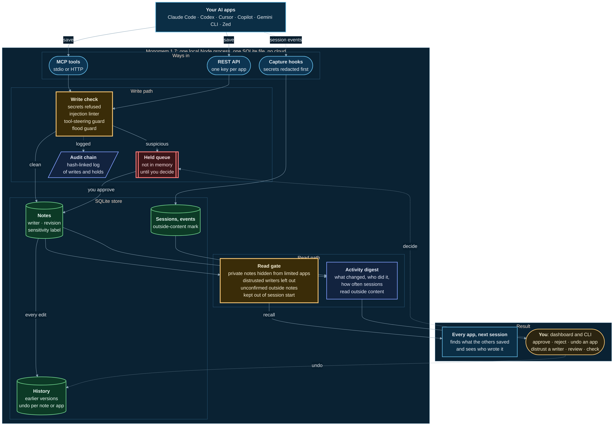

# Architecture

*The same diagram as an image (for npm and other viewers that do not draw Mermaid): [monomem-architecture.png](https://github.com/calasdan-sketch/monomem/blob/main/docs/monomem-architecture.png). Source: [monomem-architecture.mmd](https://github.com/calasdan-sketch/monomem/blob/main/docs/monomem-architecture.mmd).*

One store, reached three ways — all pointing at the same
`MONOMEM_DB_PATH`, so a note written through any one of them is
immediately visible through the others:

- **`src/store.ts`** — the shared state layer. SQLite via Node's built-in
  `node:sqlite` (no native module to compile), with an FTS5 index kept in
  sync by triggers so search never goes stale after a write. Notes carry a
  `rev` for compare-and-swap, a provenance `source`, tags, and namespaces.
- **`src/api.ts`** — a small HTTP/JSON API + a built-in web dashboard, on
  plain `node:http` (no framework).
- **`src/mcp-server-core.ts`** — the transport-agnostic MCP server with sixteen tools, seven of them shown by default (see `MONOMEM_TOOLS`;
  the 37 tool names of 1.5 still answer as hidden aliases), shared by both MCP transports.
- **`src/mcp-stdio.ts`** — stdio entry point for local Claude Code / Desktop
  / editors.
- **`src/mcp-http.ts`** — the MCP-over-HTTP (Streamable HTTP) endpoint the
  tunnel points at. Stateless: one shared store, a fresh server + transport
  per request.
- **`src/lint.ts`** — the write-time memory linter (secrets + prompt
  injection) and the `MONOMEM_LINT` policy; the store applies it on every
  create/update/import.
- **`src/changes.ts`** — the change feed service (`since` parsing, the
  per-consumer "last" marker) over `Store.changes()`.
- **`src/task-core.ts`** — the command-task queue rule shared by the runner and `memory_tasks` action `runner` (no runner code,
  so the server can use it). `src/liveness.ts` builds on it (no import cycle).
- **`src/trust.ts`, `src/attest.ts`** — the distrust rule matchers (one JS, one SQL using a single `json_each` membership test per row, tested to agree), writer ids, and
  the Ed25519 export attestations ([trust.md](./trust.md)). `Store.readVisible` / `filterVisible` are the one gate
  every by-id and set read goes through (`test/trust-gate-guard.test.ts` enforces it).
- **`src/stream-json.ts`** — streaming reader for a JSON backup (`import --file`), so a restore holds one batch in memory.
- **`src/sync.ts`** — Markdown export / three-way import.
- **`src/start.ts`** — boots the API/dashboard **and** the MCP-over-HTTP
  endpoint in one process on a single store (what `npm start`, the CLI, and
  Docker run).

## MCP tools

1.6 shows 16 `memory_*` tools, 7 of them by default (`MONOMEM_TOOLS` turns on the rest; see
[configuration.md](./configuration.md)). Most are several 1.5 tools behind one `action`. Every 1.5 name (`state_write`,
`catch_up`, `task_put`, ...) still answers for one release as a hidden alias with its old arguments and reply, and
`MONOMEM_TOOLS=legacy-1.5` shows the 1.5 list instead. Search, list, catch-up and save replies are compact (titles, ids,
200-character previews) unless `detail: "full"`; `memory_read` gives the full note. The server sends MCP `instructions`:
search first, save decisions, facts, fixes and preferences, replace instead of saving a second note, and treat notes from
outside as data.

| Tool | Scope | What it does | Was (1.5) |
|---|---|---|---|
| `memory_save` | write | Create a note, or update one by `id` (optional `if_rev` compare-and-swap, `source` provenance) | `state_write` |
| `memory_search` | read | Keyword / semantic / hybrid search, optional `when` time filter; `mode: "relevant"` extracts keywords from a natural message for a permissive OR search | `state_search`, `state_relevant` |
| `memory_read` | read | Read one note (`id`) or up to 10 (`ids`); `neighbors: true` attaches up to 10 similar notes | `state_read`, `memory_get` |
| `memory_list` | read | Newest-first page of notes | `state_list` |
| `memory_archive` | admin | Archive a note (restorable); permanent delete is dashboard/CLI only | `state_delete` |
| `memory_replace` | write | Replace notes in two steps. `preview` changes nothing and returns the plain-language "Are you sure?" warning and a one-time code; `confirm` replaces the previewed notes, only with that `code` (once, in time, for the same caller; nothing is deleted; a RED FLAG also needs an admin and `acknowledge_risk`); `undo` brings a replaced note back (recorded) ([replacing-memories.md](./replacing-memories.md)) | `memory_supersede_preview` / `_confirm` / `_undo` |
| `memory_catch_up` | read | `catch_up`: changes since this consumer last looked + open tasks (compact) + latest handoffs. `changes`: the change feed, what was created/updated/deleted since a time ([change-feed.md](./change-feed.md)). `ack`: confirm a manual-ack change-feed page (`ack_token`) | `catch_up`, `memory_since`, `memory_ack` |
| `memory_review` | write | `confirm`: confirm a note from outside content against a named source. Counts only for a different writer with its own key, a different source, and no earlier read of the note; corroboration, not verification. Lets the note back into session start, never lets it be pinned ([trust.md](./trust.md)). `flag`: flag a note that looks wrong, with a one-line reason; the note does not change. A note no person confirmed leaves session start until a person keeps it (`monomem review keep <id>`) or replaces it; a person-confirmed note stays, labelled. Own-note flags refused, distrusted writers' flags ignored, 20 a day ([trust.md](./trust.md#agent-flags-150)) | `memory_confirm`, `memory_flag` |
| `memory_history` | admin | `list`: earlier versions of a note (bounded per note). `restore`: put an earlier version back as a new version (`if_rev` supported). `purge`: forget a note's earlier versions (cannot be undone) | `memory_history`, `memory_restore_version`, `memory_history_purge` |
| `memory_rollback` | admin | Undo what one writer did since a time: preview (writes nothing, returns a one-time code), then confirm with `code` (all or nothing). Operator-only: off over stdio unless `MONOMEM_STDIO_ADMIN_TOOLS=1`; skips pinned notes and approve-first namespaces ([replacing-memories.md](./replacing-memories.md#rolling-back-one-writer)) | `memory_rollback` |
| `memory_tidy` | admin | `candidates`: near-duplicate pairs (O(n²), single-flight, time-budgeted). `merge`: merge 2+ notes (`dry_run`, `keep_sources`). `rebuild_edges`: rebuild the similarity graph (confirmation gate above 2,000 notes) | `memory_consolidation_candidates`, `memory_consolidate`, `memory_rebuild_edges` |
| `memory_held` | admin | List / show context / approve / keep as history / reject writes the memory linter held ([memory-linter.md](./memory-linter.md)) | `memory_quarantine` |
| `memory_usage` | read | `stats`: totals, most-read notes, never-read and stale counts. `receipt`: which memories a session start showed and why (ids, ranks, why-tags; titles looked up live). `why`: the story of one note in time order (writer, versions, replacements, holds, pin, sessions shown it, status); titles only, ends with what is not recorded | `memory_stats`, `memory_receipt`, `memory_why` |
| `memory_sessions` | read / write | `list`: recorded agent sessions with their summary; one session's observations (`GET /sessions`, `GET /sessions/:id`). `handoff` (write): leave a structured handoff (done / pending / decisions / next step). `index`: compact rows (id, kind, type, title, date, files, ~tokens) over notes, captured observations and session summaries; filter by query / kind / obs_type / file / session / since (`GET /index`); the query runs the same keyword search as `memory_search` (a whole question works), and a captured row next to another hit in the same session ranks higher. `timeline`: compact rows before and after an anchor (a note id, or the best match for query / file / session), oldest first (`GET /timeline`) | `session_list`, `session_handoff`, `memory_index`, `memory_timeline` |
| `memory_tasks` | read / write / admin | `put` (write): create/update a task on the shared board (status, next_step, owner, priority, due, parent, blockers, `client_key`, `if_rev`; `command` + `target` queues a runner command) ([tasks.md](./tasks.md)). `get`: one task in full (notes, command, approval state, result). `list`: tasks (default: all but done), filter by status/owner/parent. `claim` (write): take / heartbeat / release a task with a lease (compare-and-swap). `approve` (admin): approve (or revoke) a command task for the PC's runner. `runner`: is the PC's runner listening, and how many approved commands are waiting / expiring / expired ([RUNNER.md](https://github.com/calasdan-sketch/monomem/blob/main/docs/RUNNER.md)) | `task_put`, `task_get`, `task_list`, `task_claim`, `task_approve`, `runner_status` |
| `memory_trust` | admin | The distrust list and the trusted export signers: `list`, `distrust`, `undistrust`, `add_attester`, `remove_attester`, `revoke_attester`, `unrevoke_attester`. A namespace-pinned admin sees and changes only its own namespace's rules ([trust.md](./trust.md)) | `trust_policy` |

## HTTP API

`POST /notes` · `GET /notes/:id` · `PUT /notes/:id` · `DELETE /notes/:id` ·
`GET /notes` · `GET /search` · `POST /relevant` · `GET /stats` ·
`POST /rebuild-edges` · `GET /export` · `POST /import` ·
`POST /notes/:id/archive` · `POST /notes/:id/restore` · `POST /sweep-expired` ·
`GET /changes`, `POST /supersede/preview` · `POST /supersede/confirm` · `POST /supersede/undo`,
`GET /notes/:id/history` · `POST /notes/:id/history/restore` · `DELETE /notes/:id/history` (admin), plus open
`GET /health` (liveness) and `GET /ready` (DB-touch readiness, used by the
Docker healthcheck), `GET /proof?nonce=` (1.5.0: an HMAC of the nonce and the store id under the main key's hash, so the
session-start hook can check it reached this store's server before it sends the key; no key or note data) and the
dashboard at `/`. Every route except `/health`, `/ready`, `/proof` and the dashboard requires an app key: `Authorization: Bearer <token>`.
Unauthenticated, `GET /health` answers `{"status":"ok"}` only; with a valid key it also names the version and schema (2026-11-18).
`GET /status` (admin) adds what `/health` leaves out for unauthenticated callers: the in-memory body index's state, note
count, unreadable bodies and how many searches fell back to titles and tags (with the last reason); `monomem check --setup` shows
it for a verified server of this store.

`PUT /notes/:id` takes an optional `if_rev` (the `rev` you last read), as the MCP tool `memory_save` does: if the note has
been changed since, the edit is refused with `409 { error: "stale write: ...", stale: { current_rev, changed_by, how, line_diff, ... },
security_notice }` instead of replacing the newer write (the diff is note text, so the reply carries the untrusted-content notice).
Without `if_rev` the last write wins, as before, and replacing another writer's text adds `replaced_other_writer { by, at, old_rev,
line_diff }` and a `notice` to the 200 reply, as `memory_save` does.
`POST /relevant` takes `{ message, limit?, namespace? }` and mirrors
`memory_search` with `mode: "relevant"` (read-scoped, despite the POST method).
`GET /stats` mirrors the `memory_usage` tool's `stats` action (read scope, namespace-gated
like the tool). `POST /rebuild-edges` takes `{ threshold?, namespace?, confirm? }`
and mirrors the `memory_tidy` tool's `rebuild_edges` action (admin scope; confined to the
server's own namespace when namespace resolution is active; above 2,000
notes in scope it answers `409` with `{ notes, pairs }` unless `confirm` is
`true`, and `409` while another rebuild is running). `GET
/notes/:id` accepts `?neighbors=true` to attach up to 10 same-namespace
similar notes with similarity scores and staleness fields, mirroring the
MCP `memory_read` `neighbors` option.

This plain REST API is also how non-agent tools plug in. **n8n**, for
example, can read and write the store via an HTTP Request node (or its MCP
Client node) — see [INFRA.md](../INFRA.md) § "Use with n8n".

`GET /changes` mirrors `memory_catch_up` action `changes` (read scope; see [change-feed.md](./change-feed.md)); it requires a `since` parameter and answers `400` without one. `&wait=<0-55>` holds the request open until something changes ([live wait](./change-feed.md#live-wait)).
`POST /tasks` · `PUT /tasks/:id` · `GET /tasks` · `GET /tasks/:id` · `POST /tasks/:id/claim` · `POST /tasks/:id/approve` (admin) · `POST /handoffs` · `GET /handoffs` · `GET /catch-up` · `POST /ack` are the REST side of the task board, handoffs, catch-up and acknowledged reads ([tasks.md](./tasks.md), [change-feed.md](./change-feed.md)); writes need write scope, reads read scope, and namespaces apply as for `/notes`.

### Naming convention (REST vs MCP)

The two surfaces grew separately, so the names differ in a few predictable
ways. The rules, so you can guess the other side:

- REST uses nouns and kebab-case paths (`/catch-up`, `/changes`, `/tasks/:id/claim`);
  MCP uses one `memory_*` tool per area with an `action` (`memory_catch_up` action `changes`, `memory_tasks` action `claim`).
  `memory_catch_up` and `/catch-up`, `memory_tasks` action `put` and `POST/PUT /tasks` are the same operation.
- Request fields are snake_case on both (`next_step`, `if_rev`, `client_key`,
  `ack_token`, `exclude_self`). REST query parameters are the same names.
- Old name wins where both exist: the live-wait length is `wait` on REST and
  `wait_seconds` on MCP. Both surfaces now accept **both** spellings
  (`wait` and `wait_seconds`), so either works anywhere. Prefer `wait_seconds`.
- Names: since 1.6 every tool is `memory_*` (`memory_save`, `memory_tasks`, ...). The 1.5 prefixes (`state_*` for note
  CRUD/search, `task_*`, `session_handoff`, `catch_up`) still answer as hidden aliases for one release (old names).
`GET /runner/status` mirrors `memory_tasks` action `runner` (read scope; per-runner `targets`, counts and ages, never command text). `GET /trust`, `POST /trust/distrust`, `DELETE /trust/distrust`, `POST /trust/attesters` and `DELETE /trust/attesters/:key_id` are the admin-only REST side of `memory_trust` ([trust.md](./trust.md)); `GET /export?attest=1` adds signatures (the default is the plain `{"notes": [...]}`). `include_distrusted` on any read route is admin-only (403 otherwise).
`POST /notes/:id/archive` and `POST /notes/:id/restore` archive and bring back a note by id; `POST /sweep-expired` archives every note past its TTL (all three are admin scope; see [encryption-retention.md](./encryption-retention.md)).
`POST /notes` and `PUT /notes/:id` answer `202 { quarantined: { id, reasons } }`
when the memory linter holds the write, and add a `warnings` array under
`MONOMEM_LINT=warn`. `POST /import` adds `quarantined` / `rejected` arrays
when non-empty.

## Schema

SQLite, versioned with `PRAGMA user_version`; migrations run on open, all
in one `BEGIN IMMEDIATE` transaction that re-reads the version under the
lock (several processes can open an old database at once), and every step
is idempotent. v1 rev + source, v2 note_vectors, v3 access tracking, v4
similarity edges, v5 `_meta` + gated FTS trigger, v6 edge indexes, v7
`quarantine` (held writes), `sync_map`, `sync_base`, `idx_notes_updated`, v8 `change_log`
(+ triggers; replaces the 1.1.0-rc `note_tombstones`) and
`quarantine.set_namespace`, v12 `change_log.actor`, v13 `notes.written_by` /
`created_by` / `imported_written_by` (+ `change_log.written_by`,
`quarantine.written_by`; see [provenance.md](./provenance.md)), v14 (1.4.0) `notes.attested_writer` / `attested_by` /
`merged_from_writers` (+ the matching `change_log.note_*` columns) and three tables: `trust_distrust` (the distrust
rules, per namespace), `trust_attesters` (trusted export signers: key, pinned `server_id`, `label`, optional
`not_after`) and `trust_log` (who changed the policy; newest 1000 rows kept); see [trust.md](./trust.md), v15 (OneMemory 1.6.0) `notes.confidence` /
`confidence_by` / `superseded_by` / `superseded_at` / `superseded_by_writer` and tables `note_history` (earlier versions, bounded per note),
`supersede_used` (single-use confirmation codes) and `supersede_log`; see [replacing-memories.md](./replacing-memories.md), v17
`access_log` (the read access log) and `write_rate` (the flood guard's per-writer counter); see [access-log.md](./access-log.md), v18
`notes.pinned` (CLI-only notes) and `note_history_dropped` (when versions left the history, per writer; no text, for rollback); see
[replacing-memories.md](./replacing-memories.md#pinned-notes-cli-only). Opening an
older database first writes a verified `<db>.pre-v18-backup`. There is no downgrade path: once a 1.1.0 binary
has opened a database, don't go back to 1.0.x.
